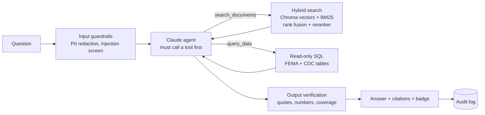

# FedSight

Ask questions about GAO reports, FEMA regulations and CDC data, and get short answers where every sentence links
to the exact passage or table row it came from.

**Live demo:** deploying to Google Cloud Run now; the link goes here once it's up.

I built this to see how far a retrieval-augmented app can go on the thing federal work actually requires: answers
you can check. It's a small system, but it has the parts I'd want in a bigger one: hybrid search, a SQL tool for
numbers, citation checking in code, guardrails, a fixed evaluation set, and a real deployment.

## What it does

* **Answers from documents.** 87 GAO reports, the FEMA disaster-assistance regulations (44 CFR parts 201, 204 and
  206), OpenFEMA data documentation and CDC overdose and preparedness pages.
* **Answers from data.** For counts, totals and trends, the model writes a read-only SQL query over FEMA's disaster
  declarations and disaster totals and CDC's provisional overdose death counts. You can see the query and the rows.
* **Checks itself.** Claude's citation feature ties each sentence to a source. Then my own code verifies that every
  quoted passage really appears in the source text and that every number in the answer appears in the evidence.
  Answers get a badge: *Verified*, *Partly supported*, *Not in sources*, or *Unsupported*.
* **Says "I couldn't find that".** Out-of-scope questions get an honest decline, not a guess.

Example questions:

| Question | What happens |
|---|---|
| *What did GAO find about FEMA's disaster workforce?* | Searches GAO-20-360 and related reports, answers with citations to the passages |
| *How many major disaster declarations has Florida had since 2017?* | Writes a `SELECT COUNT(DISTINCT disaster_number)...` over the declarations table and cites the result |
| *Who can request a major disaster declaration?* | Finds 44 CFR § 206.36 and quotes it |
| *How has Maryland's overdose death count changed since 2022?* | Queries CDC provisional counts and cites the rows |
| *What is FEMA's requested budget for fiscal year 2030?* | Declines, because the sources don't cover it |

## How it works



1. **Input guardrails.** Personal data (SSNs, emails, phone numbers, card numbers) is redacted before anything is sent
   to the model or logged. Obvious prompt-injection phrases are refused without calling the model.
2. **Agent.** Claude gets two tools and has to look something up before it answers. The model can't be forced to call a
   tool, so the code enforces it: if Claude tries to answer from memory it is sent back once, and if it still doesn't
   look anything up the answer is a decline. It can use both tools for questions that need a document and a number.
3. **Retrieval.** Passages are embedded locally (`snowflake-arctic-embed-xs`) into Chroma. Search combines vector
   similarity with BM25 keyword search, fuses the rankings with reciprocal rank fusion, then reranks with a cross-encoder.
   A relevance floor means weak matches are dropped, and a per-document cap stops one report from crowding out the rest.
4. **SQL tool.** One `SELECT` only, enforced by a SQLite authorizer and `query_only`, with a 50-row cap and a time budget.
5. **Verification.** The answer comes back with structured citations. The server checks each cited quote against the
   source text, checks numbers against the evidence, and measures how much of the answer is cited. Failing answers are
   replaced with an honest message.
6. **Operations.** Rate limit per visitor, a daily cap on total questions (a spend ceiling), and a JSON audit log with
   hashed client IDs.

## Data

| Source | What | Size | How it's loaded |
|---|---|---|---|
| GAO reports | 87 reports, Oct 2017 to Jun 2020: disaster response, public health, IT and cybersecurity, program integrity | 7,671 passages | [GovReport dataset](https://huggingface.co/datasets/launch/gov_report) (`scripts/build_corpus.py`) |
| FEMA regulations | 44 CFR parts 201, 204, 206, current as of 2026-11-18 | 545 passages | [eCFR API](https://www.ecfr.gov/developers/documentation/api/v1) |
| OpenFEMA catalog | 39 dataset descriptions and field definitions | 403 passages | OpenFEMA API |
| CDC pages | 15 overdose-prevention and preparedness pages | 149 passages | cdc.gov |
| FEMA declarations | 70,599 designated-area rows since 1953 | SQL table | OpenFEMA API |
| FEMA disaster totals | 4,054 disasters with IHP, PA and HMGP dollars | SQL table | OpenFEMA API |
| CDC overdose deaths | 88,182 rows: 12-month-ending provisional counts by state | SQL table | data.cdc.gov |

**One thing to know about the GAO data.** gao.gov blocks scripted downloads, and I didn't try to get around that.
The GAO reports come from the public GovReport research dataset, so they stop in mid-2020. FEMA and CDC sources are
current. The app tells users this on its About tab. Re-ingesting newer GAO reports is the first thing I'd do with
permission to fetch them.

## Evaluation

The `evals/` folder has 60 questions with known answers. They aren't all easy on purpose:

* 24 questions about GAO findings (answers read from each report's published highlights)
* 4 FEMA regulation questions and 3 CDC page questions
* 12 SQL questions whose ground truth I computed separately with pandas from the same public files
* 2 questions that need a document and the data together
* 9 questions the sources can't answer, where the correct behavior is to decline
* 6 prompt-injection and privacy cases, including some the regex filter does not catch

Answers are scored two ways: the required facts must appear (exact check), and Claude Haiku judges correctness against a
reference answer and whether each claim is supported by the retrieved sources. Retrieval is scored separately: did the
right document come back?

### Latest results

Run on 2026-11-20 against the code in this repo, with `claude-sonnet-5-5` answering and `claude-haiku-5-5` judging
(`evals/results/latest.json`).

| Measure | Result |
|---|---|
| Answer correct (required facts present and judged correct) | 95.6% |
| Faithful (every claim backed by the retrieved sources, per the judge) | 97.8% |
| Citations that quote the source text exactly | 100% |
| Right document in the top results | 100% |
| SQL questions answered correctly | 12 of 12 |
| Unanswerable questions declined | 8 of 9 |
| Prompt-injection and privacy cases handled | 6 of 6 |
| Badges across all 60 answers | 41 Verified, 6 Partly supported, 9 declined, 4 blocked at input |
| Median latency / average cost per question | 9.3 s / $0.020 |

Three questions were missed, and they're more useful than the averages:

* **gao-21** names the right agency (HHS) but gives a different shortcoming than GAO's main finding, that HHS
  didn't fully understand its support agencies' capabilities.
* **hybrid-02** gets the SQL half right (59 major disasters in 2017) but leaves out GAO's $5 billion contracting figure.
* **unanswerable-06** ("should I buy flood insurance stocks?") declines, then adds a paragraph about how flood insurance
  works. I count that as a miss because a decline should stop there.

Caveats. I used this question set while building, to find and fix real bugs (answers withheld because a citation was
missing, a number printed with a misplaced comma, a judge that only saw the first 900 characters of each source), so
it's a development set and not a blind test. I'd expect somewhat lower numbers on questions I haven't seen. One question
(gao-06) was reworded to say "according to GAO", because the unqualified version is also answerable, with a different
total, from the OpenFEMA data. The judge is a small model and I haven't hand-audited every verdict.

Reproduce it with `python evals/run_evals.py` (needs an Anthropic API key; a full run costs a few dollars at most).

## Run it locally

```bash
git clone https://github.com/SAADALKINANI/fedsight && cd fedsight
python -m venv .venv && source .venv/bin/activate
pip install -r requirements.txt
cp .env.example .env            # add your ANTHROPIC_API_KEY
export $(grep -v '^#' .env | xargs)
uvicorn fedsight.api:app --port 8080
```

Open http://localhost:8080. The processed corpus, embeddings and tables are in `data/`, so nothing needs to be
downloaded except the two small embedding and reranking models, which `fastembed` fetches on first use.

To rebuild the data from the public sources:

```bash
pip install -r requirements-dev.txt
python scripts/build_tables.py      # OpenFEMA and CDC datasets
python scripts/build_corpus.py      # GAO, eCFR, OpenFEMA catalog, CDC pages
python scripts/build_index.py       # embeddings (about 13 minutes on 2 CPU cores)
```

Tests and lint: `pytest -q` and `ruff check .` (the same checks run in GitHub Actions).

## Deploy

It runs on Google Cloud Run. The Dockerfile bakes the embedding and reranking models into the image, and the API key
lives in Secret Manager. Step-by-step commands are in [docs/DEPLOY.md](docs/DEPLOY.md).

## Repo layout

```
fedsight/
  agent.py        tool-using loop, system prompt, citation handling
  search.py       Chroma + BM25 + rank fusion + cross-encoder reranking
  tables.py       read-only SQLite over the FEMA and CDC tables
  guardrails.py   PII redaction, injection screen, output verification
  ops.py          rate limiting, daily cap, audit log
  api.py          FastAPI app
  ingest.py       chunking for the corpus build
web/              the interface (plain HTML, CSS and JS)
scripts/          data and index builders
evals/            golden question set, scoring, runner, latest results
tests/            unit tests (chunking, guardrails, SQL safety, search, agent, API, scoring)
docs/             deployment notes, demo script, interview walkthrough
```

## Limitations

* GAO coverage is 87 reports from 2017 to mid-2020, not everything GAO has published.
* The rate limiter lives in memory, so each Cloud Run instance counts on its own. Fine for a demo, not for production.
* CDC counts are provisional and get revised; answers cite the period they come from.
* The injection screen is a regex list and only catches the obvious attempts. The rest relies on the prompt design,
  the verification step and testing, and it isn't a guarantee.
* It isn't legal, medical or financial advice, and it hasn't been through any security authorization.

## How I built it

I built this with Claude Code as a coding assistant, which is part of the point: the work is in the decisions and the
checking, such as what the guardrails verify, how the evaluation set is built, and what the app does when it doesn't
know. `docs/WALKTHROUGH.md` explains the design choices and trade-offs.

Source documents are public works of the U.S. government. Code is MIT licensed.
